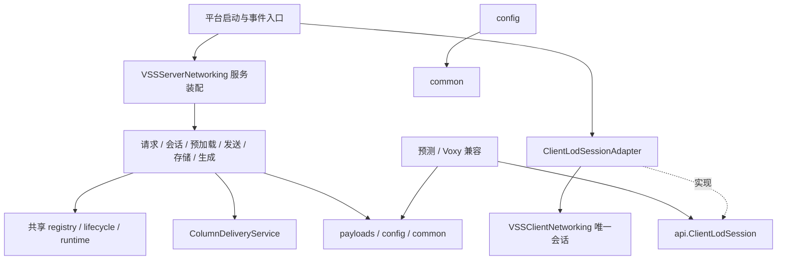

# VSS 模块与生命周期

这份说明记录当前代码边界及需要继续拆分的内部职责。两平台保留同一业务方向，Minecraft/加载器适配仍分别维护。Java package 是当前检查单位，并非 Gradle 子项目。

## 依赖方向



服务端 `VSSServerNetworking` 是装配和平台事件入口，保留公开静态适配方法。新业务通过构造参数取得共享依赖，不能再从内部调用门面取回它们。`ColumnDeliveryService` 负责已完成列的验证、transferId、分片和入队；不拥有磁盘、生成器或玩家队列。`PlayerSessionLookup` 直接读取既有 registry/lifecycle，不维护第二套在线状态。

客户端 `VSSClientNetworking` 仍是握手、距离、请求和连接状态的唯一所有者。平台客户端启动时将无状态 `ClientLodSessionAdapter` 绑定到 `VSSApi`，预测与兼容层只看接口。没有适配器时使用 `DISCONNECTED`，不能据此剔除预测覆盖。会话接口不替代 Voxy 真实 GPU 覆盖索引。预测缓存身份同样通过会话契约读取，由原 ClientConnectionIdentity 保持唯一状态；未知身份返回 null。

完整方环算法 `StrictLodFrontier` 已移到 common，数据与 GPU 就绪证据由调用方提供。它不查询网络或世界，不维护第二套覆盖索引。预测与兼容生产代码禁止依赖整个 networking.client 实现包，包括静态门面、适配器和连接身份实现。

`JsonConfig` 保留配置模型和加载器目录适配，`JsonConfigStore` 接受目录、处理 JSON 与 help/校验回写。坏文件保留，缺失文件创建默认值；存储器不缓存配置对象。`VSSLogger` 的动态开关由启动入口提供，避免 common 与 config 循环初始化。

## 预测渲染所有权

预测计算仍由 Rust / Java 后端和 PredictionTileManager 调度。受支持的 Voxy 渲染系统就绪后，PredictionVoxySource 发布不可变体素数据，VoxyPredictionBridge 在构网读取阶段将其与真实数据合成，由 Voxy 负责网格、原生 LOD、遮挡和绘制。预测不写入真实持久缓存，不作为服务端真实列已存在的证据；适配未就绪时等待 Voxy 消费者恢复。详细边界见 [0.3.6 使用与升级说明](release-0.3.6-player-guide.md)。

## 模块目录

每个表项对应独立的 `package-info.java`；详细依赖、线程与失败规则以该文件和边界测试为准。

| 生产包 | 职责 |
| --- | --- |
| [`api`](../src/main/java/dev/xantha/vss/api/package-info.java) | 客户端列消费扩展、列数据契约与客户端 LOD 会话查询接口。 |
| [`api.worldgen`](../src/main/java/dev/xantha/vss/api/worldgen/package-info.java) | 服务端地形快照扩展点、密度特征声明与可用快照选择。 |
| [`api.column`](../src/main/java/dev/xantha/vss/api/column/package-info.java) | 专服安全的整列三态、光照策略、段内／每列高度和 API 能力查询；ColumnCoverageApi 从原列缓存读取不可变归属及版本，详见 [查询契约](column-coverage-api-20261022.md)。 |
| [`client`](../src/main/java/dev/xantha/vss/client/package-info.java) | 客户端启动、设置界面、Voxy/Sodium/Embeddium 选项接入。 |
| [`client.prediction.feature`](../src/main/java/dev/xantha/vss/client/prediction/feature/package-info.java) | 在隔离的特征放置环境中记录预测装饰，不直接修改真实客户端世界。 |
| [`client.prediction`](../src/main/java/dev/xantha/vss/client/prediction/package-info.java) | 预测需求、地形采样与缓存、Voxy 预测体素输出。内部 package-private 类型属于同一实现模块。 |
| [`common`](../src/main/java/dev/xantha/vss/common/package-info.java) | 坐标、完整方环就绪前沿、带宽、计数、日志、反射和存储身份等通用基础工具。 |
| [`common.processing`](../src/main/java/dev/xantha/vss/common/processing/package-info.java) | 列的载入/编码表示及压缩编解码。 |
| [`common.worldgen`](../src/main/java/dev/xantha/vss/common/worldgen/package-info.java) | 世界生成 JSON、密度引用、能力描述和模板摘要等共享快照数据。 |
| [`compat`](../src/main/java/dev/xantha/vss/compat/package-info.java) | 可选模组接入、Voxy 摄取/上传跟踪、实际节点覆盖与严格交接。 |
| [`config`](../src/main/java/dev/xantha/vss/config/package-info.java) | 配置模型、校验、字段帮助和 JSON 持久化。 |
| [`mixin.client`](../src/main/java/dev/xantha/vss/mixin/client/package-info.java) | 客户端 Minecraft 与可选模组事件/渲染钩子适配。 |
| [`mixin.ftbessentials`](../src/main/java/dev/xantha/vss/mixin/ftbessentials/package-info.java) | FTB Essentials 传送过程的非阻塞适配。 |
| [`mixin.lostcities`](../src/main/java/dev/xantha/vss/mixin/lostcities/package-info.java) | 失落城市可选目标检测及旧缓存并发适配。 |
| [`mixin.minecraft`](../src/main/java/dev/xantha/vss/mixin/minecraft/package-info.java) | 原版区块变更、实体跟踪访问和方块实体 ticker 生命周期钩子。 |
| [`mixin.voxy`](../src/main/java/dev/xantha/vss/mixin/voxy/package-info.java) | Voxy 摄取、模型烘焙、网格任务、上传、绘制与深度阶段的版本适配。 |
| [`networking.client`](../src/main/java/dev/xantha/vss/networking/client/package-info.java) | 握手、请求窗口、重试、分片装配、列处理、存在性报告及远玩家状态。 |
| [`networking.command`](../src/main/java/dev/xantha/vss/networking/command/package-info.java) | 客户端/服务端共用的指令说明与帮助文本组织。 |
| [`networking`](../src/main/java/dev/xantha/vss/networking/package-info.java) | 平台网络注册、发送入口和世界生成配置传输装配。 |
| [`networking.payloads`](../src/main/java/dev/xantha/vss/networking/payloads/package-info.java) | 协议消息、序列化、大小检查与列传输元数据。 |
| [`networking.server.broadcast`](../src/main/java/dev/xantha/vss/networking/server/broadcast/package-info.java) | 远玩家/载具同步与广播策略。 |
| [`networking.server.command`](../src/main/java/dev/xantha/vss/networking/server/command/package-info.java) | 服务端指令注册、权限校验、配置操作与 chunky 任务控制。 |
| [`networking.server.compat`](../src/main/java/dev/xantha/vss/networking/server/compat/package-info.java) | 失落城市规划/基础设施快照和服务端可选模组接入。 |
| [`networking.server.diagnostics`](../src/main/java/dev/xantha/vss/networking/server/diagnostics/package-info.java) | 网络/生成/存储统计的汇总与诊断展示。 |
| [`networking.server.dirty`](../src/main/java/dev/xantha/vss/networking/server/dirty/package-info.java) | 合并真实区块变更并通知客户端撤销旧列。 |
| [`networking.server.generation`](../src/main/java/dev/xantha/vss/networking/server/generation/package-info.java) | 常规列生成、chunky 扫描/生成队列、任务预算及增量可用通知。 |
| [`networking.server`](../src/main/java/dev/xantha/vss/networking/server/package-info.java) | 服务端平台事件与共享服务的唯一装配入口。 |
| [`networking.server.preload`](../src/main/java/dev/xantha/vss/networking/server/preload/package-info.java) | 已存在区域的扫描、预读和客户端缺失列补齐。 |
| [`networking.server.request`](../src/main/java/dev/xantha/vss/networking/server/request/package-info.java) | 批量请求、取消/控制消息与缓存→磁盘→生成读取管线。 |
| [`networking.server.runtime`](../src/main/java/dev/xantha/vss/networking/server/runtime/package-info.java) | 任务执行器、读写容量、共享读取和服务端生命周期协调。 |
| [`networking.server.sending`](../src/main/java/dev/xantha/vss/networking/server/sending/package-info.java) | 列交付准入、分片、优先级发送窗口、带宽与已生成列刷出。 |
| [`networking.server.session`](../src/main/java/dev/xantha/vss/networking/server/session/package-info.java) | 玩家注册/握手、客户端已知列查询、世界生成配置与模板快照交付。 |
| [`networking.server.state`](../src/main/java/dev/xantha/vss/networking/server/state/package-info.java) | 玩家请求注册表、取消标记、发送队列、预载前沿与客户端已知列。 |
| [`networking.server.storage`](../src/main/java/dev/xantha/vss/networking/server/storage/package-info.java) | 列内存缓存、持久化区域文件、区块节序列化与异步写入入口。 |
| [`(root)`](../src/main/java/dev/xantha/vss/package-info.java) | 模组启动与平台装配；在启动入口创建或绑定公共服务。 |

## 状态和资源所有权

| 状态/资源 | 唯一所有者与调用约定 | 失效和清理 |
| --- | --- | --- |
| 玩家请求、已知列、发送队列 | `PlayerRequestRegistry` / `PlayerRequestState`；游戏属性由服务端线程读取 | 取消、登出、重握手、停止按原请求状态机处理 |
| 服务端运行 epoch | `ServerLifecycleGuard`；`ServerNetworkingLifecycle` 串行启停 | 提交捕获版本，完成回服务端线程再次检查；旧结果不得复活请求 |
| 磁盘执行器与容量 | `DiskTaskRuntime`；文件工作在执行器，调用方安排游戏回调线程 | 成功/异常/拒绝/取消都归还容量；停止关闭共享运行时 |
| 已完成列交付 | `ColumnDeliveryService` 读取共享请求、配置和生命周期 | 非完整且无过滤来源的列报 not-generated，失效范围/背压保持原响应；负预载编号不向客户端响应 |
| 客户端网络会话 | `VSSClientNetworking`；接口同步读取，重同步由实现切回客户端线程 | 重连/离开世界复用原清理路径，适配器不复制状态 |
| 预测 CPU 数据与任务 | `ClientPredictionState` 管维度会话，`PredictionTileManager` 管任务/缓存 | 完成结果须带版本；过期结果丢弃并释放租约/暂存 |
| 性能审查快照 | `PredictionPerformanceMonitor` 在客户端持有最多 600 条标量快照；`PredictionPerformanceService` 后台读取与服务 | 只观察计数，不修改工作预算；世界/模式变化重建速率基线，后台查询线程不访问 Minecraft 或 GL |
| Voxy 真实覆盖 | `StrictLodVisibility` 与现有 Voxy 节点/管线索引 | 只有已确认可绘制的覆盖才能撤销预测；真实覆盖撤销需恢复回退 |
| GPU 场景、上传与缓冲 | Voxy 渲染系统；VSS 不创建第二套预测 GPU 场景 | 不能让后台线程直接操作 OpenGL，停用/切维度需清理 |
| 配置对象 | 具体 CONFIG 持有者；加载/显式保存做同步 I/O | 存储器不另缓存，动态调用读取当前配置；坏文件不覆盖 |

禁止把 Minecraft 可变世界访问、GPU 生命周期或没有版本校验的结果直接搬到工作线程。线程安全容器只保证容器操作，不能证明所装的游戏对象可以跨线程访问。

## 自动检查的范围

`tools/verification/modules.gradle` 定义：

- `architectureTest`：导入生产字节码，检查 api/common/config 的依赖方向、服务端不引用客户端、payload 不引用两侧实现、预测/兼容不得依赖 networking.client 实现包、JSON 存储不加载 Minecraft/加载器；检查每个包的四项注释。另有正反 fixture 验证检查器能识别字段依赖。
- `moduleRegressionTest`：固定范围的接口/配置、请求状态、运行时、交付、会话、预加载和 Voxy 交接 CPU 回归。每个测试类独立 JVM，避免加载器静态初始化串扰。
- `planningConsumerTest`：单独运行七类规划调用方 CPU 回归（加载、内存生命周期、覆盖和祖先规划），按类隔离 JVM，并为诊断写入提供独立临时目录。修改规划/调度/居民生命周期时补跑，不等同于完整普通 `test`。
- `columnFilterTest`：整列过滤、光照、缓存隔离、分片与局部覆盖回归；按类隔离 JVM。接口细节见 [整列过滤接口](column-filter-api-20261020.md)。
- `verifyModules`：聚合 `architectureTest`、`moduleRegressionTest`、`columnFilterTest`；`check` 也依赖它，但普通 `test` 不等于这个固定回归集合。

边界检查不证明所有运行时反射、字符串类名和专服类加载都正确，也不覆盖 GPU 画面。`IntegratedPregenBridge` 仍以类名探测客户端并先判断专服环境。服务端可依赖专服安全的 `CuriosCompat` 等适配，不能粗暴禁止整个 compat 包。

明确保留的边界例外：`VSSServerCommands`、`VSSChunkyCommands`、`FarPlayerBroadcaster`、`DirtyColumnBroadcaster` 仍调用服务端门面；payload 的 `ServerIdentityS2CPayload.fromConfig()` 与列默认编解码入口仍使用配置。新实现不得复制这些例外。

## 实验与测试范围

旧的独立 GPU 渲染器及依赖其内部接口的实验测试已经移除；当前默认测试源不再保留这些类的排除名单。历史算法与对照资料位于 `tools/prediction/`，不参与生产打包；不能以旧实验报告代替当前统一渲染路径的验证。

日常回归使用 `src/test/java` 中的共享初始化与体素夹具。`tools/verification/performance-regression.gradle` 只运行当前 CPU 观察、帧间隔、加载统计与命令测试，不宣称测量 Voxy GPU 开销。

涉及 Voxy ingest、流体烘焙和真实覆盖的改动，运行以下现有回归任务。该集合中的真实字节码/Mixin 用例要求同时提供新版和旧版 Voxy JAR，缺少输入会失败；不能把它们当成无需外部输入的 CPU 门禁。

```powershell
.\gradlew.bat -I tools/compat/ingest-retained-tests.gradle ingestRetainedTest `
    "-PvssVoxyJar=C:\path\to\current-voxy.jar" `
    "-PvssLegacyVoxyJar=C:\path\to\legacy-voxy.jar" --no-daemon
```

此历史 init script 会修改 JAR 输出目录，因此只用于回归；发行打包应使用普通 `jar`。其他测试所需的原生库、模组 JAR 和 GPU 等输入必须注明是否实际提供，跳过的用例单独记录。

## 本轮类型迁移

`networking.client.StrictLodFrontier` 已迁到 `common.StrictLodFrontier`，并迁移对应测试与调用。它是内部就绪算法，不是 `api` 包的扩展点；若外部代码曾直接引用旧全限定名，需要更新引用。没有保留重复的旧实现。`ClientLodSession` 新增稳定缓存身份查询，默认断线返回 null，适配器仍读取原连接身份，不新建缓存身份状态。

## 预测规划的内部边界

2026-10-20 的第二轮拆分把 TileManager 的四条后台准备通道交给 `PredictionPlanningPipeline`。它只拥有任务槽位及作业/交接/丢弃计数，不拥有已发布目标、瓦片、内存租约或 GPU 对象。任务执行和代次失效统一使用 `PredictionClientPreparation`，原视角通道自己的 future/generation/poll/clear 实现已经删除。

| 边界 | 输入与职责 | 线程与所有权 |
| --- | --- | --- |
| `PredictionPlanningPipeline` | 组织计划、视角分类、调度排序、加载统计四通道；每通道最多一个保留任务 | 客户端线程提交/轮询/失效，共享原低优先级执行器计算；不等待任务退出 |
| `PredictionPlanPreparation` | 根据不可变输入及显式传入的稀疏覆盖快照计算目标 | 不再查询 ClientPredictionState；覆盖读取器由装配入口注入，在后台任务内获取快照 |
| `PredictionDemandPreparation` | 视角分带、近期可见目标和父级/相邻覆盖依赖 | 串行工作线程只缓存路径；所有发布的集合不可变，不管理异步生命周期 |
| `PredictionPlanningValidity` | 检查计划/视角/调度/加载结果是否仍适用于当前场景 | 客户端线程提供当前标量和快照身份；Voxy 活上传证据仍在客户端线程验证 |
| `PredictionTileManager` | 捕获输入、消费被接受的结果、维护需求/瓦片/资源预算 | 唯一 CPU 场景状态所有者；不再分别维护四套准备任务及其计数 |

普通计划保留 128 方块的小幅移动容忍；加载统计额外要求相同计划列表、居民快照、可绘制快照、视角分带身份及加载版本。暂停/关闭显式拒绝所有交接，调度通道也遵守这条规则。覆盖撤销版本改变或 Voxy 失去上传证据时，旧计划不能撤掉预测回退。

传送、暂停、关闭统一调用 pipeline.invalidate()。失效仍保留旧任务槽位至实际完成，连续失效不能不断添加新任务；旧结果完成后丢弃并释放引用。四通道共享原执行器，没有新增线程池或第二套需求缓存。祖先展开算法从 TileManager 移到 PredictionLodPlanner，生产及测试调用均已迁移，没有保留重复门面。

`verifyModules` 现纳入规划通道/有效性测试，以及原有传送、运行中需求变化、主线程准备、视角精化和粗层交接回归。字节码检查禁止计划算法、视角算法和有效性检查器直接依赖 ClientPredictionState、客户端网络实现或 Voxy 兼容层。反射测试夹具的旧字段访问统一迁移到测试支持类，生产代码不保留仅供测试的旧字段。

## 预测数据与渲染边界

`PredictionTileManager` 保留采样、CPU 缓存、任务预算和带版本的体素发布。`PredictionVoxelData` 只持有 Voxy 列运行段、植物方块和采样来源，不拥有 GPU 网格。`PredictionRenderer` 只观察帧、实际投影与相机需求，并保留雾效和显式截图审查。Voxy 负责构网、LOD、遮挡、上传与绘制。

统一路径的初始计划只提供有界的空间粗覆盖，地形和植被精度由 Voxy 的局部细分与构网请求驱动。精细体素完整保留采样得到的植被；密度过滤、成品网格缓存、独立提交路径与 VSS 顶点预算已移除。Voxy 适配失效时取消过期发布并保留可恢复的地形与装饰源缓存。

原生视口观察优先于原版回退，采用实际投影和视口高度。Iris 阴影等辅助调用传入 null 或非正宽高时，观察入口在访问客户端和矩阵之前返回；不重置有效主画面、不消费覆盖重启。公共 Mixin 回归会执行转换后的入口，而非仅检查调用符号。
