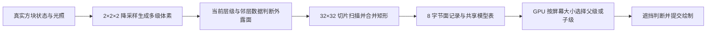

# prediction voxy merge investigation 20261011

> 历史记录：保留当时的实现、输入与验证结果，不能据此判断当前版本的渲染架构、配置或兼容范围。 当前说明见 [文档目录](../../README.md)，相关旧报告见 [历史索引](../README.md)。

**Voxy 的远景减面方案值得迁移。核心是先降低三维体素分辨率、重新生成外露面，再合并整片属性一致的矩形。VSS 现有的局部合并和显示网格简化还没有覆盖这套过程。**

本轮按用户要求调查两套已安装 Voxy，并与当前 NeoForge/Forge VSS 工作区比较。完成实际 JAR 字节码和 shader 核对、实际 ScanMesher2D 执行，以及历史真实网格的离线合并机会统计。没有取得当前客户端同场景 GPU/FPS 对照；本轮没有实现新的生产体素 LOD，也没有新构建包。

调查日期：2026-10-11。历史语料来自 2026-10-10 的 geometry 捕获，不能代表用户已经部署最新植被渲染包后的现场。

**实际版本与证据**

| 环境 | 已安装 Voxy | SHA256 |
| --- | --- | --- |
| NeoForge 1.21.1 | voxy-0.2.15-beta.jar | 802d49edc07c4e4a7af15ffd59337a82af383dfd551b67c278233098737e2f52 |
| Forge 1.20.1 | voxy-0.2.14-alpha-51ea1a841fff1717b261d2fbd3b3f6dafd470663.jar | f4cdee485ab8031682673068e65ff2fbe325d7214c6cfff430449058e13a63fa |

JAR 位于 `F:/NovaEngineering-World整合包/.minecraft/versions` 中对应实例的 mods 目录。只读取文件，没有替换实例。

实际 JAR 的 shader、javap 输出、校验信息及离线脚本保存在 [本轮证据目录](C:/Users/Administrator/.codex/tmp/vss-voxy-merge-20261011/provenance.json)。NeoForge JAR 的关键 shader 与 `voxy-compare/main-voxy` 匹配，包括屏幕投影、层级遍历、quad 格式、模型和 UV 解码；另一份 `neoforge-voxy` 源码已有不同的 Mipper 和遍历规则，因此本报告以安装包为准。Java 算法的关键分支另用实际 JAR 字节码核实。

**Voxy 的生成与提交过程**

1. **网格生成前降低体素分辨率。** 每组 8 个子体素输出一个代表体素。安装版 Mipper 对非空气候选使用 `(opacity << 4) | cornerPriority` 选最大值，取得对应方块、biome 和光照记录；全空气组计算光照平均值。它没有按方块出现次数投票，也没有按 targetLevel 设置最少非空气数量的接口。Mapper 对 LeavesBlock 将降采样 opacity 设为 15，这影响保留树冠的代表选择，不能解释为树叶渲染时一律不透明。
2. **在选定体素层级重新判断外露面。** 相邻完全不透明体素用占据位掩码的变化找边界；非不透明模型仍检查面是否存在、是否可被邻面遮住、同模型是否自剔除。邻 section 的表面也参与，减少 section 边缘重复面。树叶透明度和特殊模型有独立元数据，不能把所有叶块相邻面无条件删除。
3. **对整片二维切片扫描并合并。** ScanMesher2D 在 32×32 切片上先形成横向相同数据的连续段，再与上一行相同长度和数据的段合并。该版本长宽各最多 16 个体素。相同模型 ID、有效 biome、光照、方向和渲染类型等进入 64 位数据键，属性不同的面保持分开。这是扫描线贪心合并，不保证数学上全局最少矩形。
4. **用共享的方块代理模型。** 模型阶段捕获六个方向的颜色/深度图，每面是 16×16，计算该面的边界、缩进、alpha、tint 和遮挡元数据，运行时绘制这些方向上的代理矩形。复杂方块内部的原始构件不直接逐个搬进远景网格。植物仍可能有多个方向的面，仍可能执行 alpha discard；不能认定每株草必然比 VSS 的两个十字面更少。
5. **合并后的面保留重复纹理。** shader 从共享模型表取该方向的图像，UV 按合并矩形的体素尺寸重复，再乘层级尺度定位世界坐标。大的几何面不会简单把一张草或砖纹理拉伸铺满。
6. **GPU 选择层级并保持父子互斥。** GPU 计算 section 的屏幕投影面积，超过 subdivision 阈值才访问子节点。正常路径有子节点时遍历子级；需要细级但子节点尚未就绪时请求它们并暂用父网格；不继续细分时提交当前网格。NodeChildRequest 等必要子结果齐备后才发布子指针。遮挡剔除随后避免处理不可见节点。数据和网格更新发生在生成/上传路径，相机移动不要求每帧重新合并几何。

Voxy 将一张规则矩形的局部位置、尺寸、模型、biome 和光照压入 8 字节，模型图集和共享表另计。这个固定记录大小有价值，但只有合并和层级重建真正改变面数；字节大小与帧率不成线性关系。

可读源码与安装包证据：

- [Mipper](C:/Users/Administrator/Desktop/voxy-compare/main-voxy/src/main/java/me/cortex/voxy/common/world/other/Mipper.java:18)、[实际 Mipper 字节码](C:/Users/Administrator/.codex/tmp/vss-voxy-merge-20261011/neoforge/Mipper.javap.txt:10)。
- [ScanMesher2D](C:/Users/Administrator/Desktop/voxy-compare/main-voxy/src/main/java/me/cortex/voxy/client/core/util/ScanMesher2D.java:24)、[实际扫描器字节码](C:/Users/Administrator/.codex/tmp/vss-voxy-merge-20261011/neoforge/ScanMesher2D.javap.txt:55)。
- [RenderDataFactory 的外露面规则](C:/Users/Administrator/Desktop/voxy-compare/main-voxy/src/main/java/me/cortex/voxy/client/core/rendering/building/RenderDataFactory.java:355)、[模型捕获](C:/Users/Administrator/Desktop/voxy-compare/main-voxy/src/main/java/me/cortex/voxy/client/core/model/ModelFactory.java:224)。
- [安装包的层级选择](C:/Users/Administrator/.codex/tmp/vss-voxy-merge-20261011/neoforge/assets/voxy/shaders/lod/hierarchical/traversal_dev.comp:124)、[安装包的屏幕面积计算](C:/Users/Administrator/.codex/tmp/vss-voxy-merge-20261011/neoforge/assets/voxy/shaders/lod/hierarchical/screenspace.glsl:89)。

**VSS 当前已经做了什么，缺口在哪里**

两套 VSS 都已经有地形 LOD、放置方块占据判断、粗树体素、竖向外露面合并、地表矩形合并和部分墙面合并。不能将当前实现描述为完全没有合并或始终绘制每个方块六面。

| 当前路径 | 已有能力 | 影响后续减面的限制 |
| --- | --- | --- |
| PredictionVegetationRuns | 相邻占据判断、同状态竖向外露面连续段 | 逐 mesh cell 输出；细级顶部仍多为 1×1，水平联合依赖后续合并 |
| PredictionQuadMerger | 在生成时尝试合并同色、同材质、轴对齐矩形 | 只查看同 cell 内最近 64 个四边形；斜向草花十字面不适用 |
| PredictionQuadMesh | 地表完整格子的贪心合并、相容墙面的水平连续段 | 地形墙面识别明确排除 feature box 的相反绕序，不能覆盖全部树冠/建筑面；保留着色和归属语义 |
| PredictionVegetation.reduceBlocks | 粗级在共同世界格点缩并木质/树叶方块 | 精细生成阶段的树保持尺寸 1；显示距离变化不自动为已驻留 feature 建立完整体素金字塔 |
| PredictionDisplayGeometry | 共用 XYZ 格点移动、删除退化面、局部矩形合并，准备 3 个显示变体 | 移动排除 CUTOUT、模型、流体和若干边界；合并仍只查最近 64 个候选；变体要求至少减少 35% 面数，并受总额外存储 50% 限制 |
| PredictionDisplayLod | 已上传表示按 1.5 px 误差选择，含滞回 | 只能选择已经构建成功的表示；近处、望远镜等保护继续生效 |
| 20 字节矩形/十字 GPU 记录 | 精确压缩顶点记录并保留原坐标 | 记录压缩不删除几何面，不能替代网格合并 |

这里最明显的结构差别是：Voxy 先改变粗体素的占据关系，再重新提取外壳；VSS 显示变体主要从已有表面移动顶点、合并仍能相接的矩形。顶点移动不能等价解决所有重叠内部面、不同层表面和复杂轮廓问题。

对应 VSS 代码：[植被面连续段](C:/Users/Administrator/Desktop/voxyserverside-neoforge-1.21.1/src/main/java/dev/xantha/vss/client/prediction/PredictionVegetationRuns.java:18)、[局部矩形合并](C:/Users/Administrator/Desktop/voxyserverside-neoforge-1.21.1/src/main/java/dev/xantha/vss/client/prediction/PredictionQuadMerger.java:9)、[地形墙面识别](C:/Users/Administrator/Desktop/voxyserverside-neoforge-1.21.1/src/main/java/dev/xantha/vss/client/prediction/PredictionQuadMesh.java:357)、[显示变体](C:/Users/Administrator/Desktop/voxyserverside-neoforge-1.21.1/src/main/java/dev/xantha/vss/client/prediction/PredictionDisplayGeometry.java:26)。Forge 对应路径具有相同算法限制。

**实际扫描器执行验证**

离线 Java probe 直接将两套已安装 JAR 的 ScanMesher2D 加载执行。逐格复原输出矩形并核对原始数据，验证没有漏格、越界、重叠或跨材质合并，两套版本结果一致：

| 32×32 输入切片 | 非空单元 | 输出矩形 |
| --- | ---: | ---: |
| 16×16 同属性区域，其余为空 | 256 | 1 |
| 32×32 全部同属性 | 1,024 | 4 |
| 两种材质棋盘格 | 1,024 | 1,024 |
| 非空/空气棋盘格 | 512 | 512 |
| 固定随机种子的混合切片 | 771 | 499 |

这证明合并效果依赖空间连续性和属性一致性。`256 → 1` 是规则切片验证，不能当作真实森林或整个客户端的减面比例。[执行结果](C:/Users/Administrator/.codex/tmp/vss-voxy-merge-20261011/actual-scan-probe.json)。

**历史真实网格的进一步合并空间**

使用既有 3,890 个独立网格的捕获语料，按 spacing 分桶、按面数排序，每桶均匀选择最多 20 个无 morph 网格；过滤到每个网格 128～131,072 个不透明面，共 115 个网格。分析原始不透明面，包含地形和 feature，水面不计。

脚本将 canonical 坐标恢复到整数的 1/16 方块单位，仅选同方向的完整轴对齐矩形、均匀且完全一致的四角 RGB/天空光、相同 sprite 和所有材质/几何标志。排除模型 UV、unshaded、流体、真实边界、preview 和已有显示近似。既不移动顶点，也不改颜色；相邻边严格相接才合并，最长合并边为 256 方块。迭代按两个方向合并邻接矩形，检查总面积不变，并测试孔洞、重叠和跨度限制。

| 统计方案 | 源面数 | 几何候选合并后 | 找到的减面空间 |
| --- | ---: | ---: | ---: |
| 同一 source cell，扩大查找范围 | 1,512,475 | 1,393,405 | 119,070，7.87% |
| 顶面跨 cell、侧面保持垂直归属列，允许切向联合 | 1,512,475 | 1,273,566 | 238,909，15.80% |
| 其中识别为 LeavesBlock 的面，第二种规则 | 34,547 | 27,215 | 7,332，21.22% |

这是**离线几何机会统计**：源坐标、属性和面积保持，但没有生成经过生产 range/coverage/visibility 处理和 GPU 逐像素对照的新网格。跨 cell 合并尤其需要逐像素归属与正确恢复原范围，否则一个单元被 Voxy 接管时会错误隐藏其它单元。不能将上述比例当作已实现的无损渲染收益。

取样按 spacing 分层而非按本帧可见面积或面数加权，统计完整源网格而非当前已选绘制范围；没有外推整个 3,890 网格、当前候选数量或实际 FPS。它也不包含三维降采样重建外壳的收益，并且排除了草花的斜向十字面。图形性能还受片元量、深度/alpha、批次切换和实际瓶颈影响。

数据与方法：[统计 JSON](C:/Users/Administrator/.codex/tmp/vss-voxy-merge-20261011/merge-opportunity.json)、[离线脚本](C:/Users/Administrator/.codex/tmp/vss-voxy-merge-20261011/merge_opportunity.py)。

**适合本项目的实施顺序**

1. **先增加贯穿整个瓦片平面切片的精确矩形合并。** 利用已有完整源网格，在工作线程按方向、平面和完整属性键组织外露矩形，扩大水平及竖向联合范围。优先处理树冠、建筑外墙与屋顶、雪层等 feature，利用公共世界 UV 保留纹理重复。让精确合并独立于“近似显示变体必须减少 35%”的门槛，小于 35% 的稳定收益也能进入正常 mesh。跨 cell 部分配套改造逐像素归属、CPU 范围选择与隐藏/恢复记录。
2. **再为远处树冠、建筑及合适的地形建立三维占据的显示层级。** 直接利用采样的列区间、放置方块和城市模板，在固定世界格点构建稀疏 2/4/8 级代表数据，从每个级别重新提取外表面并合并。保留树冠、屋顶、建筑开口和悬挑的重要轮廓；近处及望远镜回到原始表示。沿用屏幕误差、滞回和就绪回退，父级与子级按区域互斥。只保留有收益的层级，继续管理 CPU 压缩缓存及 GPU 驻留预算。
3. **草花使用独立的显示表示和合并策略。** 现有两个对角十字面通常不能用轴对齐矩形合并直接处理。可以借鉴 Voxy 的模型捕获和固定格点代理，但需测不同视角、alpha 孔洞、光照和近处密度。只增加远处 LOD 不会自动解决近处草花的片元成本；近处可见草花、资源包外观和望远镜效果必须单独对照。
4. **最后用真实客户端 A/B 决定投入下一层复杂度。** 同场景同时记录提交四边形数、细小图元占比、顶点/不透明 GPU 时间、片元工作与显存；如果平面联合后细图元仍占主要成本，继续推进粗体素层级。如果总 GPU 时间没有随面数下降，需要继续定位片元、深度和批次成本。

构建和合并应以网格/材质/邻界版本驱动，保持在后台或既有网格准备路径。相机每帧只选择驻留层级，不扫描全部几何重建；覆盖撤销仍能立即恢复原始预测显示。预测占据和显示层级使用独立数据，不把它们登记为 Voxy 的真实覆盖。

**本轮确认了可迁移机制和具体减面空间，尚未确认新的客户端 FPS 增幅。** 两套仓库已同步本报告和机器可读记录。
