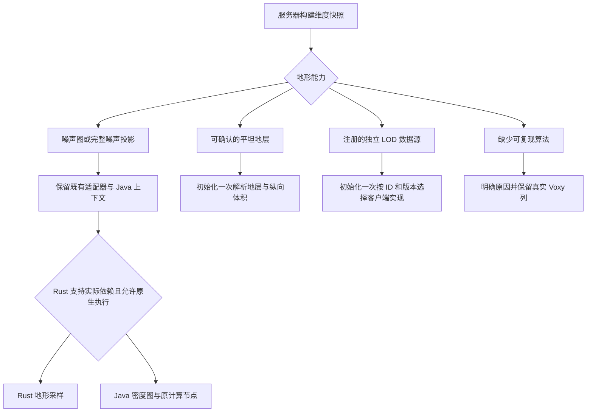

# 通用地形能力与 LOD 后端接入（2026-10-10）

> 历史记录：保留当时的实现、输入与验证结果，不能据此判断当前版本的渲染架构、配置或兼容范围。 当前说明见 [文档目录](README.md)，相关旧报告见 [历史索引](history/README.md)。 本报告路径保留，供既有验证工具及证据清单引用。

本轮在 Forge 1.20.1 与 NeoForge 1.21.1 实现统一地形描述、一次性后端选择和密度节点能力契约。兼容扩展发生在生成框架与计算节点层，保留 VSS 的 Rust、Java 密度图编译、LOD 间距采样、后台网格和真实 Voxy 列交接路径。

这不是所有地形模组都已经通过游戏验收的声明。独立算法仍需提供可复现投影或注册 LOD 数据源；未声明的 Mixin 地形替换也无法仅靠 Codec 或继承关系可靠识别。

## 已实现的选择流程



| 快照种类 | 用途 | 执行与限制 |
| --- | --- | --- |
| `NOISE_GRAPH` | 标准噪声生成器、没有改动生成方法的噪声子类、框架提供的完整投影 | 保留现有 Java / Rust 选择；`nativeCompatible` 只是额外许可，Rust 还要检查实际 Codec 依赖 |
| `FLAT_LAYERS` | 原版 FlatLevelSource 与可确认没有覆写生成行为的子类 | 解析一次材质、水体、空气间隔和完整纵向体积；所有坐标复用不可变样本 |
| `LOD_SOURCE` | 不能等价表达为现有噪声图的独立算法 | 客户端按后端 ID 与服务端 revision 区间选择一次，然后直接调用来源对象 |
| `UNAVAILABLE` | 无可复现描述或运行时资源不完整 | 不生成无关噪声；现有显式注册的旧后端仍可接管，诊断会标为 `BACKEND_OVERRIDE` |

`GeneratorTerrainCapabilities` 在初始化时比较运行时继承方法签名。只改变 Codec 的别名子类可复用基础算法；覆写生成方法的子类需显式声明。比较不依赖 Forge SRG 方法名字符串，也不执行生成方法。

没有把 `fillFromNoise`、完整 Java 区块生成、原版区块调度作为通用默认回退。原有材质、特征和模板重放路径继续保留。

## 服务器公共接口

接口位于 `dev.xantha.vss.api.worldgen`：

- `TerrainSnapshots.register(provider)`：按优先级注册，初始化时选中第一个适用结果。一个 provider 可以覆盖整个生成框架及其配置，无需按每个模组名称注册。
- `TerrainSnapshotProvider.capture(context)`：读取生成器、注册表和配置，返回 `Optional.empty()` 表示不适用。
- `TerrainSnapshotContext.requireRegistry(key)`：把复现算法所需的自定义注册表纳入依赖闭包。
- `TerrainSnapshot.noise(id, revision, nativeCompatible, projection)`：提供完整投影，至少包含 `settings` 和 `biome_source`。
- `TerrainSnapshot.lod(id, revision, parameters)`：提供独立来源的配置，客户端必须注册同一 ID。

以下是框架接入示意，其中 `FrameworkGenerator` / `FrameworkBridge` 由集成模组实现，不是 VSS 已内置的模组类：

```java
TerrainSnapshots.register(new TerrainSnapshotProvider() {
    public String id() { return "example:framework"; }
    public int priority() { return 10; }
    public Optional<TerrainSnapshot> capture(TerrainSnapshotContext context) {
        if (!(context.generator() instanceof FrameworkGenerator generator))
            return Optional.empty();
        context.requireRegistry(generator.configurationRegistry());
        JsonObject projection = FrameworkBridge.noiseProjection(generator, context.ops());
        // false 保留原 Java 计算。确认可等价运行且 Rust 支持图中所有依赖后才改 true。
        return Optional.of(TerrainSnapshot.noise(id(), 1, false, projection));
    }
});
```

投影会替换默认噪声描述，不能无意继承原算法的 TerraBlender / FreeTerraForged 运行标记。如果投影需要这些数据，应显式提供完整内容。投影禁止覆盖执行契约、实际生成器 Codec、内部错误字段及独立来源参数字段。

参数采用防御性复制。实际生成器 Codec 是可选初始化资料，失败或超过快照预算时可以舍弃，不能导致独立投影失效。独立来源也不会因可选噪声上下文序列化失败而丢失。普通 RuntimeException / LinkageError 隔离到 provider 或维度，CancellationException 及 VM 致命错误继续传播。

## 客户端独立 LOD 来源

客户端公共接口为 `PredictionLodBackends`、`PredictionLodContext` 和 `PredictionLodSource`。在客户端初始化阶段注册，避免专用服务端加载客户端类。

```java
PredictionLodBackends.register("example:framework", 1, 2, context -> {
    JsonObject parameters = context.parameters();
    long seed = context.profile().seed();
    // 只初始化一次。实现自行持有其不可变配置或每线程计算状态。
    return FrameworkBridge.openLodSource(seed, parameters, context.registries());
});
```

来源必须遵守这些约定：

1. `sample(blockX, blockZ, stepBlocks)` 使用绝对方块坐标。step 是请求的 LOD 间距，不能改变随机种子、材质 ID 含义或放置序列。
2. 查询应可并发调用。可变缓存需每线程保存，或由实现提供恰当同步；不能任意读取玩家正在修改的真实世界状态。
3. 返回非 null 的 `ClientColumnSample`。水体、无地面、预览、悬空或地下信息须准确表示，不能用高度假造完整实体柱。
4. 批量 `sampleGrid` 必须保留 target 中已有的非 null 项，它们可能是缓存或真实区块采集。默认实现已遵守，TileManager 分成最多 8×8 的批次，并在批次之间检查取消、暂停和版本。
5. `preview` 可单独实现低成本预览，近似结果需保留相应 provenance flags。最终采样不能直接把近似记录当成精确结果。
6. `biomeIndex` 对应来源给出的稳定 `biomes()` 顺序，或显式初始化的 noiseContext 的顺序。不得在查询过程中改变列表顺序；未知索引可使用 -1。没有生物群系上下文时应显式提供需要的颜色查询。
7. 洞穴、悬空和多层水体可通过 `PredictionColumnVolume.ofRuns(int[])` 创建不可变体积。每组为 `[bottomInclusive, topExclusive, blockRegistryId, fluidKind]`，按高度不重叠排序；fluidKind 为 0 / 1 / 2（无 / 水 / 岩浆）。空气通过区间空隙表示。该工厂会复制、验证输入。
8. 若 `interiorTerrain()` 为 true，每次采样必须包含完整 volume。`column(x,z)` 则提供可选的精确纵向查询。特殊非立方块模型仍属于原有装饰 / 网格路径，不能仅用 block ID 的体积格式表达所有形状。
9. 服务端配置格式或语义改变时增加服务端 revision；客户端算法语义独立改变时增加 `cacheRevision()`。后端 ID、两侧版本、参数、注册表、种子、维度高度共同隔离持久缓存。
10. `close()` 在工作线程退出后调用，并由包装器保证重复释放幂等。长查询需支持中断和取消。

`PredictionLodContext.generator()` 可懒解码可选的实际生成器 Codec。`noiseContext()` 可在 factory 中懒初始化可用的噪声 / 生物群系 / 装饰上下文；这两个操作不应在每个采样点调用。选中来源后不再查注册表、反射或解析 JSON。缺少客户端实现、版本不匹配、factory 失败都不会转去画无关噪声。

## 优化模组与密度节点契约

`DensityFunctionTraits` 支持具体类注册或实例实现 `Aware.vssDensityTraits()`，只在图分析阶段读取。

```java
// 仅对确实只由坐标决定、且不依赖 Y 的具体计算类声明。
DensityFunctionTraits.register(MyHorizontalDensity.class,
        DensityFunctionTraits.Traits.coordinate(true));

// 编译器或优化模组拥有上下文、线程缓存、插值状态时保留其原始计算对象。
DensityFunctionTraits.register(MyRuntimeCache.class,
        DensityFunctionTraits.Traits.runtimeOwned());
```

`coordinate(false)` 表示坐标纯函数，但依赖 Y。class 注册只匹配精确类型，不自动给未知子类授予纯度。`runtimeOwned` 会阻止 VSS memo、mapAll 替换、上下文替换和包含它的已知父图重写；全部根由外部拥有时不提交重复编译任务，状态为 `external`。

能力声明必须与算法真实行为一致，尤其不能把动态上下文节点声明为坐标纯函数。保留优化模组的执行对象意味着能够继续使用它的 evaluator；不代表 VSS 必然取得该模组在完整 NoiseChunk / 区块调度中的全部加速。

实际验证采用 **C2ME NeoForge 0.4.0-alpha.0.122+1.21.1** 发布包中的 DFC 组件，覆盖 mapAll 与编译缓存类型限制、原对象保留及重复坐标求值。验证对象是 DFC 契约，不是整包 ModLauncher 启动或全部优化模块。对应 Forge 的 **C2MEF 0.2.0+alpha.12 / 1.20.1** 发布包没有 DFC 组件，因此该发行包不能用于同一 DFC 测试。

## 本轮兼容范围

- 原有标准噪声、TerraBlender、Blueprint、FreeTerraForged、BetterEnd 等入口没有被改成完整区块生成；各自原有边界继续有效。
- 基于公共噪声描述的多个地形数据包 / 框架可共用现有通路；未知自定义 Codec 仍需正确的客户端注册表与 Java 实现。
- FlatLevelSource 的连续地层、void、水层、空气间隔、悬空地层和地下流体已有采样与网格回归。此入口只提供基础地形，不宣称完整复现任意 flat 自定义装饰。
- ATM10 审查中的 Undergarden、Bumblezone、Eternal Starlight、Allthemodium 自定义生成器等，不能仅凭新增 API 就标为全部支持。覆写基础生成行为的版本需要框架 provider / source 和实际坐标对照。
- 结构模板本地资源校验、按需补传与缓存继续使用上一轮实现。这套地形能力 API 没有取消结构放置、特殊地标或模板模型本身的必要适配。

## 验证与性能对照

相关回归使用本轮隔离源码构建，覆盖能力选择、provider 故障隔离、取消传播、旧后端显式接管、完整悬空网格、水体、缓存版本与参数隔离、真实采集保留、密度图编译、注册表依赖、网络分片、模板交付和 profile 发布。

| 加载器 | 回归总数 | 通过 | 条件跳过 | 失败 |
| --- | ---: | ---: | ---: | ---: |
| NeoForge 1.21.1 | 145 | 141 | 4 | 0 |
| Forge 1.20.1 | 144 | 139 | 5 | 0 |

两侧的 4 项跳过是没有输入 Tectonic / Lithostitched 实际 JAR 的条件案例；Forge 另有上述缺少 DFC 组件的条件案例。跳过没有计为通过。打包后的密度编译 / traits 测试另外独立执行，Forge 使用实际 SRG Minecraft 运行库。

性能对照在同一 JVM 中分别加载修改前的 sampler classes 和本轮 classes，使用相同原版噪声图、种子 42、fixed plains、16 方块间距。保留 Java 编译器，触发并等待密度编译，关闭精确高度缓存。每侧 32 轮 × 1,024 点：前 16 轮预热，后 16 轮统计，交替执行顺序。输出全字段逐列一致；结果比较不计入计时。

| 指标（最终串行运行，两个加载器分开测量） | NeoForge 修改前 → 本轮 | Forge 修改前 → 本轮 |
| --- | --- | --- |
| 逐列比较 | 32,768 / 32,768 完全一致 | 32,768 / 32,768 完全一致 |
| 1,024 点批次 wall 中位数 | 26.199 → 26.315 ms | 25.924 → 26.362 ms |
| 16 个统计批次 wall 合计 | 419.761 → 421.545 ms | 413.782 → 417.785 ms |
| 每批分配中位数 | 1,948,136 → 1,948,136 B | 1,997,288 → 1,997,288 B |
| 统计分配合计 | 34,528,440 → 34,528,440 B | 35,360,184 → 35,341,112 B |

最终 wall 合计分别增加约 0.42% / 0.97%，属于这组短微基准观察到的小幅差异，不能据此证明绝对无开销或取得游戏 FPS 收益。NeoForge 每批分配均一致；Forge 一批相差 19,072 B，本轮更少，未发现新增采样分配。Windows ThreadMXBean CPU 时间存在 15.625 ms 量化步长，因此不把 CPU 列当成细微性能变化的证明。

此对照测的是原版噪声 sampleSurface 路径，没有测完整整合包进档、FPS、独立外部算法或所有装饰。后端选择、JSON 与反射移到初始化的结论有源码与单次 factory 调用回归支持；更复杂模组的实际生成速度仍需对应 provider 与坐标 / 游戏测量。

## 构建与使用

- 协议升级到 **52**，worldgen profile 格式升级到 **5**。客户端和服务端应同时使用本轮包。
- NeoForge 编译目标 Java 21；Forge 编译目标 Java 17，完成 reobfJar。
- 产物位于各仓库 `lib/terrain-capabilities-20261010/`，含 SHA256SUMS、BUILD-INFO 与 validation.json。
- 交付使用任务开始时的隔离源码快照叠加本轮文件，避免把另一聊天同时改动的渲染文件混入验收。那些工作区改动已保留；本轮产物不是并行渲染任务的合并发布包。
- 没有安装到游戏目录、启动客户端、提交或推送 GitHub。

原始最终 CSV 与汇总在本仓库 `docs/terrain-capabilities-validation-20261010.json` 中列明。公共接口源码与测试已同步到两个仓库。
